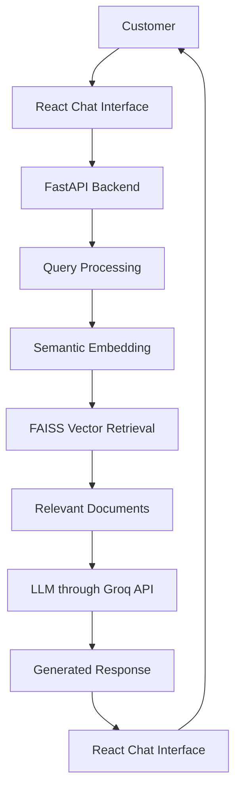

# AI Customer Support System using Retrieval-Augmented Generation (RAG)

An intelligent AI-powered customer support application that answers customer queries using Retrieval-Augmented Generation (RAG), product information, order records, and company policies.

The system combines semantic document retrieval with a Large Language Model (LLM) to generate context-based responses and assist customers with common support requests.

---

## Project Overview

Traditional customer support systems often depend on static FAQs, predefined responses, or manual assistance. Finding accurate information can become difficult when customers ask questions in different ways or need information from multiple sources.

This project addresses these challenges by developing an AI Customer Support System that retrieves relevant information from a knowledge base and generates natural-language responses.

The application supports:
- Product-related questions
- Return, refund, exchange, and cancellation policies
- Shipping and payment queries
- Order-related information
- Customer support ticket escalation
- Fallback responses when relevant information is unavailable

## Key Features

- **RAG-based question answering:** Retrieves relevant knowledge before generating an answer.
- **Semantic search:** Understands the meaning of customer questions rather than relying only on exact keyword matches.
- **AI-generated responses:** Uses an LLM through the Groq API.
- **Knowledge base integration:** Uses FAQs, product information, and policy documents.
- **Order information retrieval:** Supports queries involving customer order records.
- **Support escalation:** Helps route complex queries to human support.
- **Confidence and escalation indicators:** Displays response-related information in the chat interface.
- **Conversation handling:** Supports conversation IDs to maintain chat context.
- **React frontend:** Provides an interactive customer support interface.

## Technology Stack

| Component | Technology |
|---|---|
| Programming language | Python |
| Backend framework | FastAPI |
| API server | Uvicorn |
| Frontend | React.js |
| Frontend development tool | Vite |
| Frontend technologies | HTML, CSS, JavaScript |
| LLM API provider | Groq |
| Default LLM model | `openai/gpt-oss-120b` |
| Embedding model | `BAAI/bge-base-en-v1.5` |
| Embedding integration | LangChain Hugging Face |
| Vector retrieval | FAISS |
| Reranking experiment | `cross-encoder/ms-marco-MiniLM-L-6-v2` |
| Data formats | CSV and TXT |
| Testing | Pytest |
| Response evaluation | BLEU and ROUGE |

**Note:** The cross-encoder is an experimental reranking component, not confirmed as part of the production retrieval pipeline.

## System Architecture

The application follows a Retrieval-Augmented Generation workflow.



### How the System Works

1. The customer enters a question in the React chat interface.
2. The frontend sends the message to the FastAPI backend.
3. The backend processes the question.
4. The embedding model converts the query into a semantic vector representation.
5. The retriever searches the knowledge base for relevant documents.
6. Retrieved context is passed to the LLM through the Groq API.
7. The LLM generates a response using the provided context.
8. The response is returned to the React frontend and displayed to the customer.

## Knowledge Base and Dataset

The project uses both unstructured and structured information.

### Knowledge Base

```text
data/
└── knowledge_base/
    ├── faq.csv
    ├── product_information.csv
    └── policies/
        ├── cancellation_policy.txt
        ├── damaged_product_policy.txt
        ├── exchange_policy.txt
        ├── payment_policy.txt
        ├── refund_policy.txt
        ├── return_policy.txt
        ├── shipping_policy.txt
        └── warranty_policy.txt
```

### Structured Data

```text
data/
└── structured_data/
    ├── orders.csv
    ├── order_items.csv
    ├── products.csv
    ├── support_tickets.csv
    ├── ticket_messages.csv
    └── users.csv
```

The knowledge base provides policy and product information, while structured datasets support order-related and customer-support operations.

## Application Interface

The application provides a chat-based interface where customers can enter questions and receive AI-generated responses.


### 1. Main Chat Interface


### 2. Policy Query Response


### 3. Order Information Response


### 4. Order Information Response


### 5. Support Escalation Response


## Sample Customer Queries and Results

The following examples demonstrate the types of questions supported by the application.

### Query 1: Return Policy

**Customer:**
> What is your return policy?

**Expected system behaviour:**
- Retrieve the relevant return policy document.
- Generate an answer using the retrieved information.
- Explain the applicable return conditions.

### Query 2: Damaged Product

**Customer:**
> My phone arrived damaged. What should I do?

**Expected system behaviour:**
- Retrieve the damaged-product policy.
- Explain the next steps for reporting the issue.
- Provide relevant support guidance.

### Query 3: Refund Information

**Customer:**
> How long does a refund take?

**Expected system behaviour:**
- Retrieve the refund policy.
- Explain the refund procedure and applicable time information.

### Query 4: Order Information

**Customer:**
> Where is order ORD1002?

**Expected system behaviour:**
- Process the order identifier.
- Retrieve the corresponding order information.
- Display available order and delivery details.

### Query 5: Product Information

**Customer:**
> What are the specifications of the Apple MacBook Air M2?

**Expected system behaviour:**
- Retrieve relevant product information.
- Generate a response using the available product data.

### Query 6: Human Support

**Customer:**
> I want to talk to a human.

**Expected system behaviour:**
- Identify the escalation request.
- Initiate the support escalation workflow.
- Provide ticket information when a ticket is created.

### Query 7: Unsupported Question

**Customer:**
> Tell me something that is not in the knowledge base.

**Expected system behaviour:**
- Avoid inventing unsupported information.
- Provide an appropriate fallback response.

*These are demonstration scenarios and expected behaviours. Add screenshots of the actual application responses to show the observed results.*

## Model and Retrieval Configuration

### Embedding Model

`BAAI/bge-base-en-v1.5`

This model converts text into numerical vector representations so that semantically related queries and documents can be matched.

### Large Language Model

`openai/gpt-oss-120b`

The model is accessed through the Groq API. The model can be changed through the `GROQ_MODEL` environment variable.

### Experimental Reranker

`cross-encoder/ms-marco-MiniLM-L-6-v2`

This model is used in a separate experiment to evaluate the ranking of retrieved documents.

## Performance Evaluation

The retrieval system was evaluated using manually labelled queries and relevance judgements.

### Retrieval Results

| Evaluation Metric | Result |
|---|---:|
| Precision@5 | 54.17% |
| Recall@5 | 100% |
| MRR@5 | 100% |
| MRR@20 | 55.43% |
| Hit Rate@5 | 100% |
| NDCG@5 – Existing Retriever | 97.11% |
| NDCG@5 – Experimental Reranker | 95.20% |

The Recall@5 and MRR@5 results came from an eight-query evaluation. MRR@20 was calculated using a separate ten-query benchmark. Hit Rate@5 and NDCG@5 were based on manually assigned relevance judgements.

### Response Quality Evaluation

| Metric | Average Score |
|---|---:|
| ROUGE-1 F1 | 0.2693 |
| ROUGE-2 F1 | 0.1111 |
| ROUGE-L F1 | 0.2020 |
| BLEU | 0.0124 |

These response-quality metrics were calculated using eight reference questions.

### Automated Testing

The project test suite achieved:

- **136 tests passed**

These results reflect the test run performed during project development.


## Installation and Setup

### Prerequisites

Install the following before running the project:

- Python 3.11
- Node.js and npm
- Git
- A Groq API key

### Step 1: Clone the Repository

```bash
git clone YOUR_GITHUB_REPOSITORY_URL
```

```bash
cd AI-Customer-Support-System
```

### Step 2: Create and Activate Python Environment

```bash
python -m venv ai_rag_env
```

Windows PowerShell:

```powershell
.\ai_rag_env\Scripts\Activate.ps1
```

### Step 3: Install Backend Dependencies

```bash
pip install -r requirements.txt
```

### Step 4: Configure Environment Variables

Create a `.env` file in the project root.

```env
GROQ_API_KEY=your_groq_api_key
GROQ_MODEL=openai/gpt-oss-120b
```

Never upload your real API key to GitHub.

### Step 5: Start the Backend

From the project root, run the backend command configured for your FastAPI application:

```bash
uvicorn main:app --reload
```

If your FastAPI entry-point module is located elsewhere, adjust the command to match its actual location.

The backend runs at:

```text
http://127.0.0.1:8000
```

API documentation:

```text
http://127.0.0.1:8000/docs
```

### Step 6: Start the React Frontend

Open another terminal:

```powershell
cd frontend/react-app
```

Install frontend dependencies:

```bash
npm install
```

Start the development server:

```bash
npm run dev
```

Open the local URL displayed by Vite, usually:

```text
http://localhost:5173/
```

Keep both the backend and frontend terminals running while using the application.


## Conclusion

The AI Customer Support System demonstrates how Retrieval-Augmented Generation can be applied to customer service automation.

By combining semantic retrieval, an LLM, structured customer data, and a React-based interface, the project provides a practical approach to answering customer questions using available information.

The project also demonstrates the importance of evaluating retrieval performance, response quality, and fallback behaviour when developing AI-based customer support applications.
